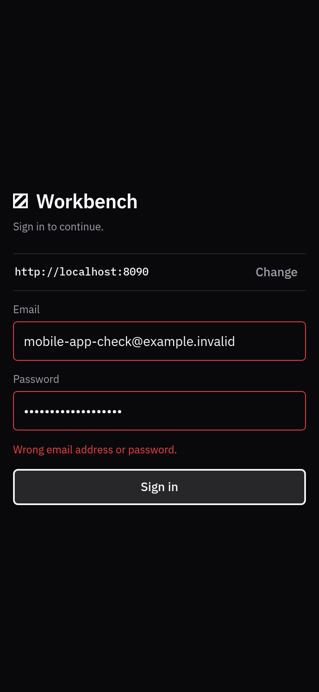
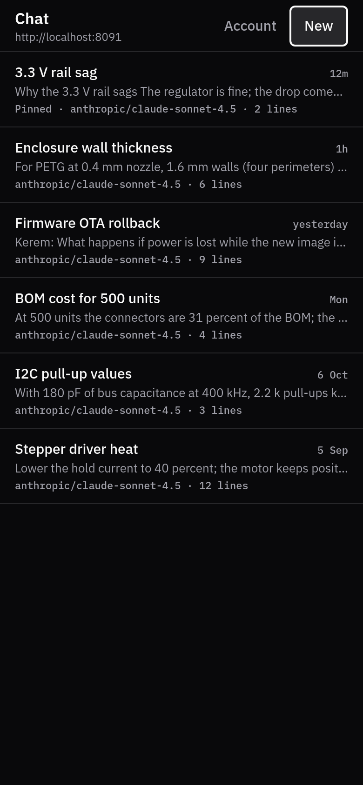
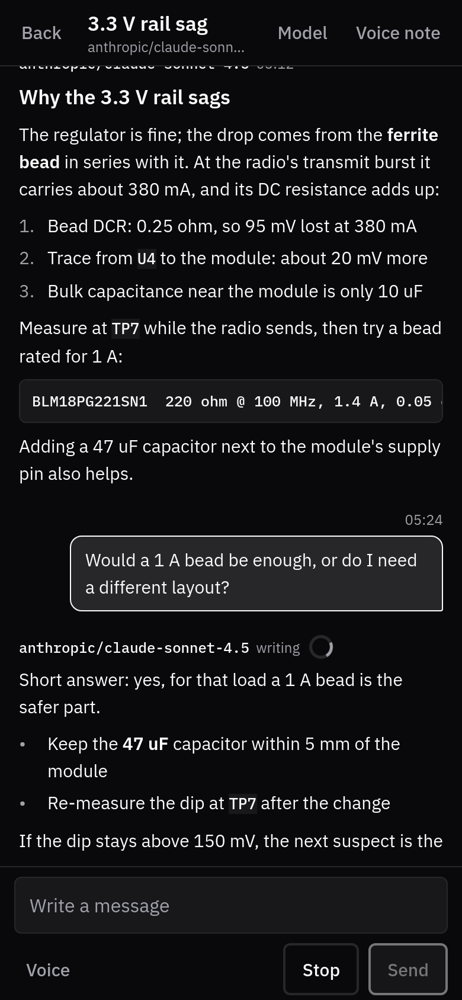
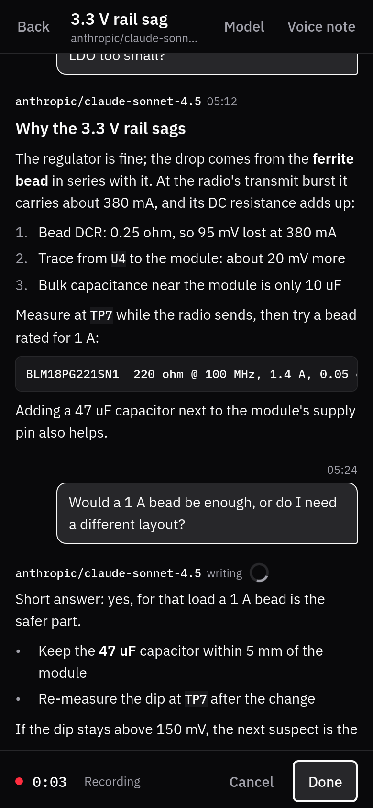
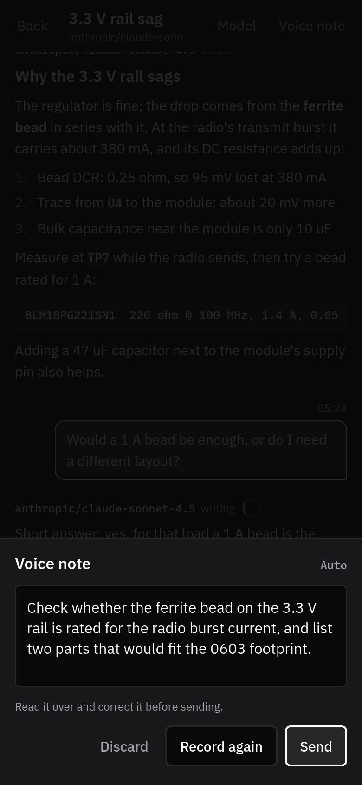
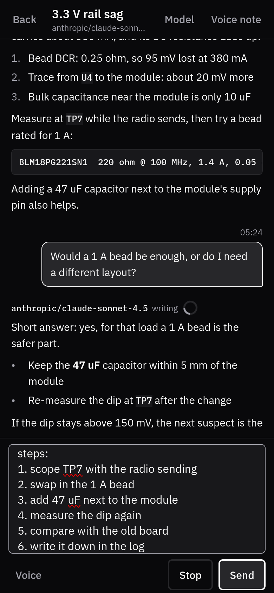
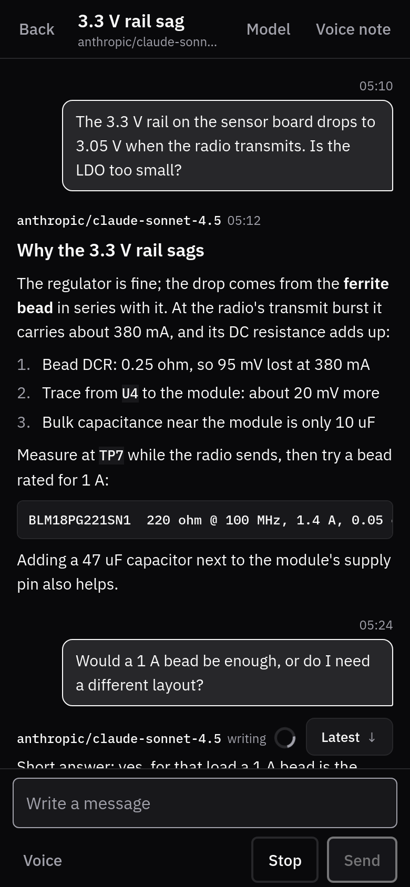

# Workbench mobile

The chat of a Workbench server on your phone: Android,
iOS and the web, from one React Native (Expo) code base, in the web app's own
Spartan Dark theme.

Nothing is built in. The first screen asks for the address of a Workbench
server - yours, your team's, anyone's - and the app remembers the last few.
Then you sign in with the same e-mail address and password as on the web.

<p>
  
  
  
  
  
</p>
<p>
  
  
  
  
</p>
<p>
  
  
  
</p>

## What it does

- **Any server.** Type an address (`workbench.example.com`, `https://...`,
  or `http://192.168.1.20:8000` on a local network). The app checks that it
  answers as Workbench (`/api/health`, `/api/auth/state`) before going on.
  The last five servers are listed for one-tap switching.
- **Sign in** with e-mail and password. A server running without sign-in
  (local mode) goes straight to the chat.
- **Chat**: the workspace's conversations (pull to refresh), open one, read
  it with Markdown (headings, lists, code, links), send a line and watch the
  answer being written, stop it, start a new conversation, choose the model.
  A conversation in which someone else's answer is being written is followed
  live. The list follows the newest line and the answer as it is written,
  unless you scroll up to read; then **Latest** brings you back.
- **Typing**: the box sits right above the keyboard, the conversation shrinks
  above it with the newest lines in view, and the box grows with what you
  write up to six lines (16 px text), then scrolls inside.
- **Voice**: the composer's Voice button records, the server transcribes
  (`POST /api/voice/transcribe`), and the text lands in the box to read and
  correct - nothing is sent by itself. Voice note (in a conversation's top
  bar) records, shows the transcript for review, then sends it. The language
  is Auto, Türkçe or English (Account).
- **Sign out**, or change server, from Account.

The device keeps only the server list, the last e-mail address per server and
the voice language. Never a password. The session is the server's own
HttpOnly cookie, kept by the platform's cookie store.

## Run it

You need Node.js 22 or newer.

```sh
npm install
npm start          # Expo dev server: press a for Android, i for iOS, w for web
```

With the [Expo Go](https://expo.dev/go) app you can scan the QR code, but voice
recording needs a development build (`npx expo run:android` /
`npx expo run:ios`) or the APK below.

### Point it at your own server

Start the app and type your server's address on the first screen. That is
all: there is no configuration file and no address in the code. To try it
against a server on your machine, use the address your phone can reach (the
computer's LAN address, not `localhost`); plain `http://` works for local
addresses.

The server needs sign-in turned on (`REDLINE_REQUIRE_SIGNIN=1`) for accounts,
an LLM key for answers, and a "voice" model for voice input - see the
Workbench documentation. Native apps need no server change.
[SERVER-CHANGES.md](SERVER-CHANGES.md) lists what a web build hosted on
another origin would need (CORS), and other optional improvements.

### In a browser

A browser applies CORS, which a Workbench server does not allow for other
origins. The dev proxy serves the web build and forwards `/api` to the
server, so both come from one origin:

```sh
npx expo export --platform web
TARGET=https://workbench.example.com node scripts/dev-proxy.mjs
# open http://localhost:8090 and enter localhost:8090 as the server
```

`MOCK=1 node scripts/dev-proxy.mjs` answers from a made-up server instead
(`scripts/mock-api.mjs`, no account needed); add `MOCK_HOLD=1` to leave
answers half-written, or `MOCK_SIGNIN=1` to start signed out (the password
`mock` signs in, any other is refused).

### Android APK (no Android Studio)

```sh
scripts/build-android.sh      # Docker: expo prebuild + gradlew assembleRelease (JS bundle inside)
# -> build-out/workbench-release.apk
adb install build-out/workbench-release.apk
# VARIANT=debug gives a debug APK, which loads its JS from Metro - not for handing out
```

## Develop

```sh
npm run typecheck
npm run lint
npm test
npm run check      # all three
```

Screenshots in `docs/screenshots` are made with `scripts/shots.sh` (headless
Chrome in Docker at 390 x 844, against the made-up server; with
`TARGET=https://your.server` the server and sign-in screens are taken against
that server, whose own wrong-password error is shown). The keyboard shot
makes the window 336 px shorter, as a phone keyboard does, and checks the
composer is still on screen. App icons are
drawn by `scripts/make-icons.js` from the web app's section mark.

### How it talks to the server

| What | Request |
|---|---|
| Is it Workbench? | `GET /api/health`, `GET /api/auth/state` |
| Sign in / out | `POST /api/auth/login` `{email, password}` (sets `redline_session`), `POST /api/auth/logout` |
| Conversations | `GET /api/cc/chats`, `POST /api/cc/chats`, `GET /api/cc/chats/{id}`, `PATCH .../{id}` (model) |
| Send and stream | `POST /api/cc/chats/{id}/messages` answers with `text/event-stream`: `user`, `thinking`, `text` (with `at`), `error`, `done`, `title`; `202` JSON when the line was queued |
| Follow someone's answer | `GET /api/cc/chats/{id}/live` (`hello`, `start`, `text`, ..., `end`, `bye`) |
| Stop | `POST /api/cc/chats/{id}/stop` |
| Models | `GET /api/llm/settings` (providers with a key), `GET /api/llm/models?provider=` |
| Voice | `POST /api/voice/transcribe` multipart `audio`, `lang`, `purpose` |

Every request that changes something carries `x-redline-csrf: 1`. React
Native has no `EventSource` and no streaming `fetch` body, so the event
streams are read through `XMLHttpRequest` progress events, which work the
same in a browser (`src/api/sse.ts`).

### Layout

```
src/
  App.tsx               fonts, session, which screen shows
  api/                  server address, HTTP client, SSE reader, types
  state/session.tsx     server -> sign-in -> app
  storage/prefs.ts      recent servers, last e-mail, voice language
  screens/              Server, Login, ChatList, Chat
  components/           Markdown, MessageItem, Composer, RecordingBar, sheets, controls
  lib/                  Markdown parser, answer-stream reducer, times
  voice/                recorder hook and its pure helpers
  theme/tokens.ts       Spartan Dark, copied from the web app's styles.css
scripts/                dev proxy, screenshots, Android build
```

### Design rules

The theme is the web app's Spartan Dark token for token
(`src/theme/tokens.ts`, from redline-studio's `frontend/src/styles.css`), set
in IBM Plex Sans and Plex Mono like the web app. Flat surfaces with 1 px
hairlines; a chosen option is shown by weight and ink, not a fill; no coloured
stripes, no emoji; recording is a small red dot and a timer. The wordmark is
the web app's section mark (a vector, `components/Mark.tsx`) beside the name.

Every screen keeps a 16 px side gutter and the safe-area insets (status bar,
cutout, gesture bar); controls are at least 44 px tall. Motion is short and
moves only opacity and transform: the native splash (the mark on the theme's
ground) fades into the first screen, a conversation slides in 12 px from the
right in 220 ms, sheets rise in 180 ms - and with the system's reduced-motion
setting on, none of it moves (`components/Appear.tsx`).

### Keyboard

The app draws edge to edge (Android 15 requires it), and then Android's
`adjustResize` no longer shrinks the window for the keyboard.
[react-native-keyboard-controller](https://github.com/kirillzyusko/react-native-keyboard-controller)
reports the keyboard frame by frame, and `components/KeyboardSpacer.tsx`
takes that room at the bottom of the chat and of the sheets, so the list
shrinks and the composer sits on the keyboard. The server and sign-in screens
scroll the focused field clear of it (`KeyboardAwareScrollView`). The
manifest keeps `windowSoftInputMode="adjustResize"`
(`android.softwareKeyboardLayoutMode: "resize"` in app.json), which the
library expects.

## Licence

MIT - see [LICENSE](LICENSE). The main Workbench repository had no licence
file when this was written, so MIT was chosen here. IBM Plex is under the SIL
Open Font License. The web app's wordmark face (Switzer) is not
redistributable and is not included; the wordmark uses Plex Sans SemiBold.
